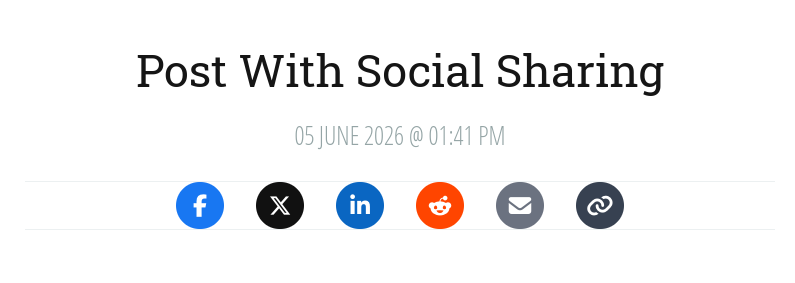

# Social Share

Social sharing buttons with secure, local share-intent counts.

> __Requires__ Devflow Version: 3.x

> __Tested Up To:__ 3.0.0

> __Requires PHP:__ 8.4+

> __Stable Tag:__ 2.0.0

> __License:__ GPLv2-only

## Screenshot



## Codex Installation

1. Start a new shell session.
2. Navigate to the root of your install, run the following command ```php codex plugin:install getdevflow/social-share```.

## Template/Theme Usage

```php
use Plugin\SocialShare\Support\SocialShareTemplate;

echo SocialShareTemplate::tag([
    'placement' => 'standard',
    'url' => site_url('/custom-url'),
    'title' => 'Custom Share Title',
]);
```

If `url` is omitted, the current request URL is used. Share buttons honor the plugin's global enabled setting.

## Share Counts

Social Share records anonymous share intents: activations of a network button or successful uses of Copy Link. External
networks do not expose a reliable browser-side confirmation that a visitor completed a share, so the displayed number
must not be interpreted as a platform-confirmed share total.

Counts are stored per site, content target, and network. Recording requests use signed same-site targets, CSRF
protection, short-window visitor deduplication, and rate limiting. No raw IP addresses or user agents are persisted.

The database table is installed automatically when the plugin is activated or first loaded after upgrading. Existing
settings are preserved.

## Changelog

### 2.0.0

- Added persistent per-network and total share-intent counts.
- Added signed, same-origin frontend recording with rate limiting and deduplication.
- Added live count updates and successful Copy Link tracking.
- Added count reset and optional data removal controls.
- Secured settings routes and hardened settings validation.
- Fixed product and floating-only placement, default shortcode URLs, activation resets, cache invalidation, and
  missing-record failures.

### 1.0.0

- Initial release.
